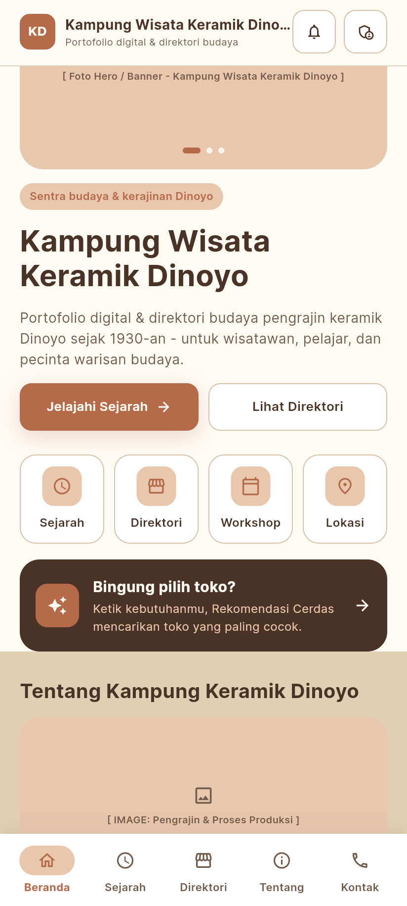
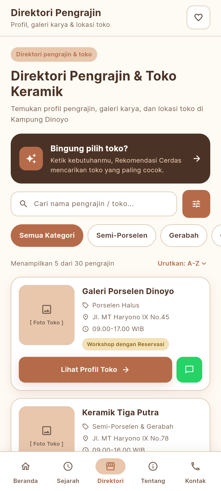
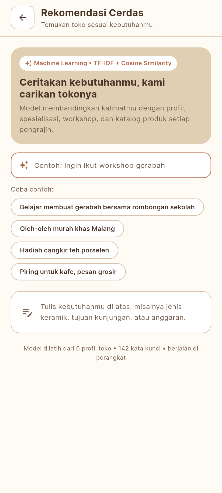
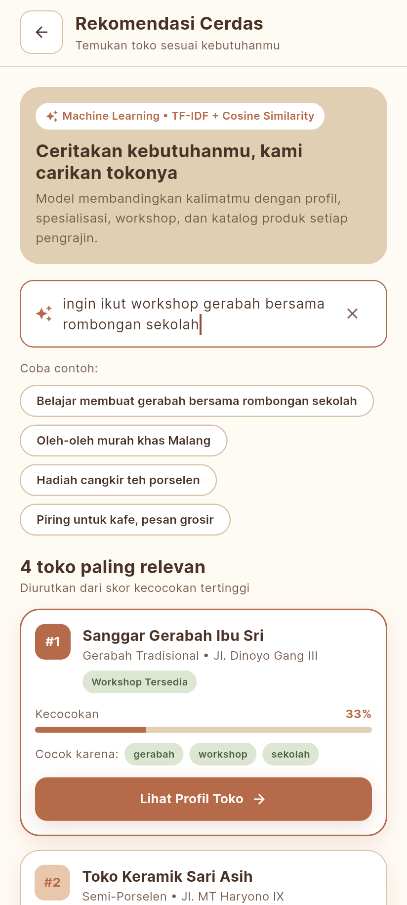
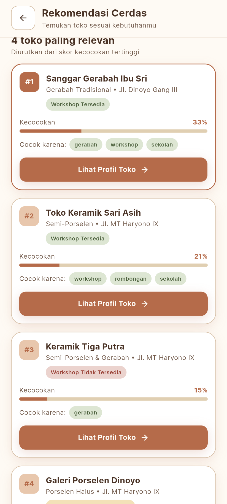
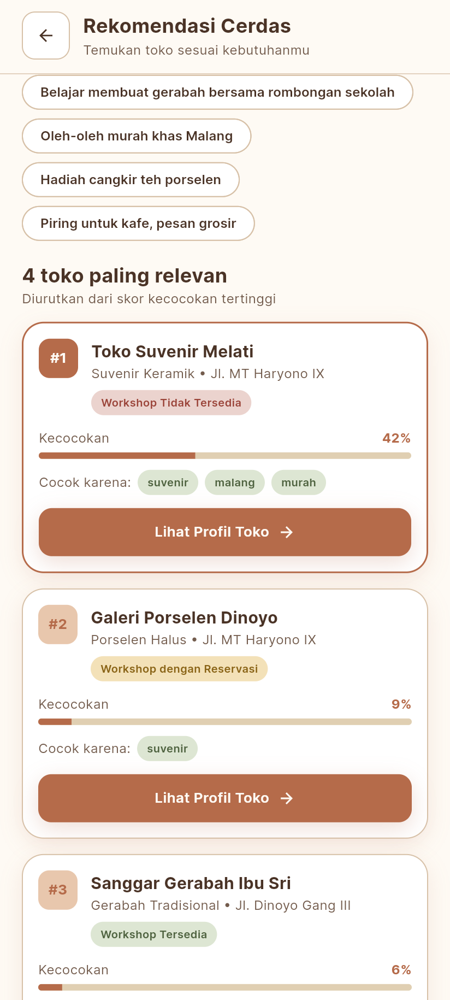
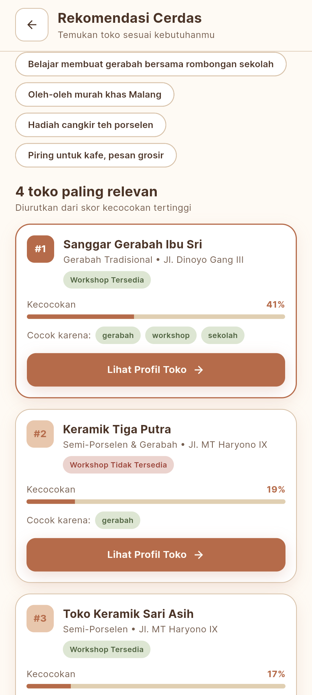
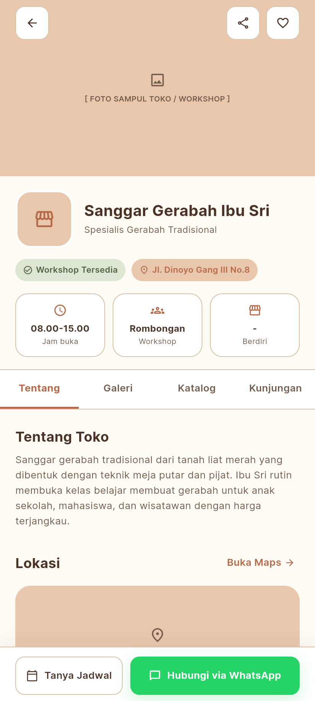
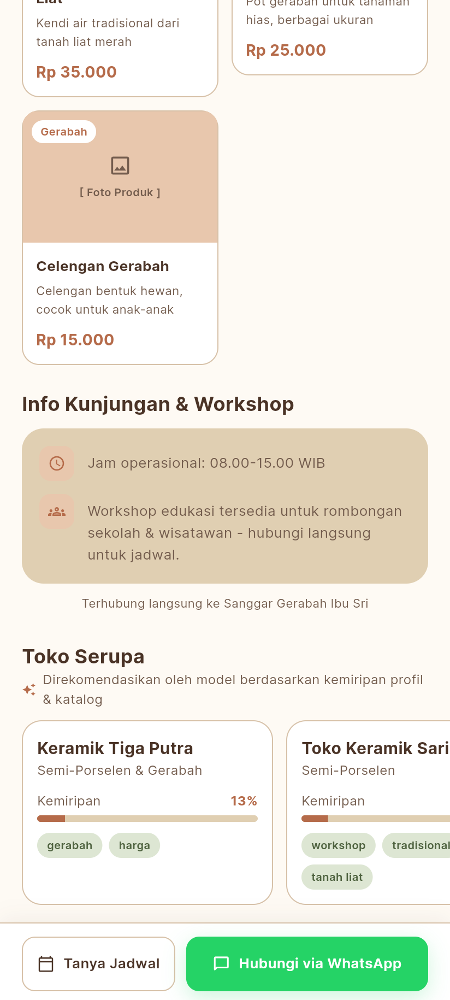
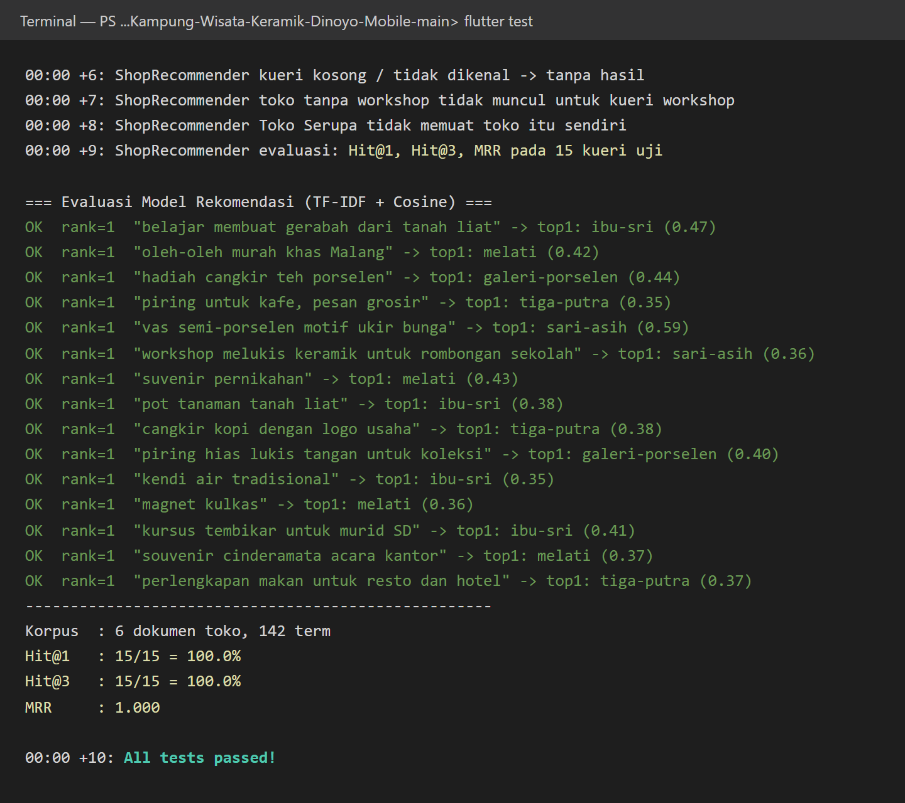

# Laporan Penerapan Machine Learning
## Aplikasi Mobile Kampung Wisata Keramik Dinoyo

---

## 1. Ringkasan

Aplikasi Kampung Wisata Keramik Dinoyo dilengkapi fitur **Rekomendasi Cerdas**. Fitur ini memakai model machine learning **Content-Based Filtering** dengan **TF-IDF (Term Frequency–Inverse Document Frequency)** dan **Cosine Similarity**.

Pengunjung cukup menulis kebutuhannya dengan bahasa sehari-hari, misalnya *"ingin ikut workshop gerabah bersama rombongan sekolah"*. Model lalu mengurutkan toko/pengrajin yang paling sesuai, lengkap dengan skor kecocokan dan alasannya. Model yang sama juga menampilkan **"Toko Serupa"** di halaman profil setiap toko.

| Aspek | Keterangan |
|---|---|
| Jenis model | Content-Based Filtering (Information Retrieval / NLP) |
| Algoritma | TF-IDF (sublinear TF, smooth IDF) + Cosine Similarity |
| Jenis pembelajaran | *Unsupervised*: tidak membutuhkan data berlabel |
| Data latih | Korpus teks profil 6 toko + katalog produknya (142 term unik) |
| Lokasi eksekusi | *On-device* (di HP pengguna), tanpa server/internet |
| Bahasa / library | Dart murni, tanpa library ML eksternal |
| Hasil evaluasi | Hit@1 = 100%, Hit@3 = 100%, MRR = 1,000 pada 15 kueri uji |

---

## 2. Model yang Digunakan

### 2.1 Content-Based Filtering

Content-based filtering merekomendasikan item berdasarkan **kemiripan isi (konten)** item dengan kebutuhan pengguna. Pada aplikasi ini:

- **Item** = toko/pengrajin keramik.
- **Konten item** = teks profil toko, yaitu nama, spesialisasi, kategori, status workshop, deskripsi, dan katalog produk.
- **Kebutuhan pengguna** = kalimat bebas yang diketik pengunjung, atau profil toko yang sedang dilihat (untuk "Toko Serupa").

Pendekatan ini dipilih karena aplikasi **belum memiliki riwayat interaksi pengguna** (rating, klik, pembelian). Metode *collaborative filtering* membutuhkan data tersebut, sehingga belum bisa dipakai. Content-based filtering sudah bisa bekerja sejak hari pertama hanya dengan data profil toko.

### 2.2 Pipeline Model

```
Teks mentah ──► [1] Preprocessing ──► [2] Vektorisasi TF-IDF ──► [3] Cosine Similarity ──► Ranking toko
```

**Tahap 1 – Preprocessing teks bahasa Indonesia** ([text_preprocessor.dart](../lib/ml/text_preprocessor.dart))

1. *Case folding*: semua huruf diubah menjadi huruf kecil.
2. Normalisasi frasa: `oleh-oleh` → `suvenir`, `tanah liat` → `tanahliat`, `cendera mata` → `suvenir`.
3. Tokenisasi: teks dipecah per kata, angka dan karakter non-huruf dibuang.
4. Penghapusan *stopword* bahasa Indonesia (`yang`, `dan`, `untuk`, `saya`, `ingin`, dst.).
5. *Stemming* ringan: akhiran `-nya` dibuang.
6. Normalisasi sinonim domain keramik, misalnya `kursus/kelas/belajar` → `workshop`, `tembikar` → `gerabah`, `souvenir/cinderamata` → `suvenir`, `murid/siswa/pelajar` → `sekolah`.

Contoh: `"Saya INGIN Kursus Tembikar di Dinoyo"` → `[workshop, gerabah, dinoyo]`

**Tahap 2 – TF-IDF** ([tfidf_vectorizer.dart](../lib/ml/tfidf_vectorizer.dart))

Setiap dokumen diubah menjadi vektor bobot kata:

$$tf(t,d) = 1 + \ln(\text{jumlah kemunculan } t \text{ di } d)$$

$$idf(t) = \ln\left(\frac{1 + N}{1 + df(t)}\right) + 1$$

$$w(t,d) = tf(t,d) \times idf(t), \quad \text{lalu dinormalisasi L2 sehingga } \lVert \vec{w} \rVert = 1$$

- $N$ = jumlah dokumen toko, $df(t)$ = jumlah dokumen yang memuat kata $t$.
- Kata yang muncul di hampir semua toko (misalnya "keramik", "dinoyo") otomatis mendapat bobot IDF kecil.
- Kata yang khas (misalnya "kendi", "pernikahan", "grosir") mendapat bobot besar.
- Rumus ini sama dengan `TfidfVectorizer(sublinear_tf=True, smooth_idf=True)` pada scikit-learn.

**Tahap 3 – Cosine Similarity** ([shop_recommender.dart](../lib/ml/shop_recommender.dart))

$$\cos(\vec{q}, \vec{d}) = \frac{\vec{q} \cdot \vec{d}}{\lVert\vec{q}\rVert \, \lVert\vec{d}\rVert} = \vec{q} \cdot \vec{d} \quad (\text{karena sudah dinormalisasi})$$

Skor bernilai 0 sampai 1 dan ditampilkan sebagai persentase **"Kecocokan"**. Toko dengan skor < 0,05 dianggap tidak relevan. Model juga mengambil 3 kata dengan kontribusi terbesar ($q_t \times d_t$) sebagai alasan **"Cocok karena: …"**, sehingga hasilnya bisa dijelaskan (*explainable*).

---

## 3. Peran Model dalam Aplikasi

Model ini menjawab masalah utama persona pengguna (Robbi, mahasiswa) yang tercantum di halaman User Persona:

> *"Tidak tahu toko mana yang sesuai kebutuhan karena minim info digital pengrajin."*

Sebelumnya, Direktori hanya punya pencarian teks biasa: pencocokan nama, spesialisasi, atau alamat secara persis. Pengguna harus tahu nama toko atau istilah yang tepat. Dengan model ini:

| Fitur | Masukan | Keluaran | Lokasi di aplikasi |
|---|---|---|---|
| **Rekomendasi Cerdas** (kueri → toko) | Kalimat kebutuhan pengguna | Daftar toko terurut + skor kecocokan + alasan | Layar baru *Rekomendasi Cerdas*, dibuka dari banner "Bingung pilih toko?" di Beranda & Direktori |
| **Toko Serupa** (toko → toko) | Profil toko yang sedang dibuka | 3 toko lain yang paling mirip + skor kemiripan | Bagian bawah halaman *Profil Toko* |

Aturan bisnis yang diterapkan di dalam model:

- Toko berstatus **nonaktif** (dinonaktifkan admin) tidak pernah direkomendasikan.
- Toko dengan status **"Workshop Tidak Tersedia"** tidak diberi kata "workshop" di dokumennya, sehingga tidak muncul untuk kueri workshop.
- Spesialisasi diberi bobot ×3 dan kategori ×2 (*field weighting*), karena kedua field ini paling menggambarkan toko.

---

## 4. Data Training

### 4.1 Apakah memerlukan data training?

**Tidak memerlukan data training berlabel.** TF-IDF + cosine similarity adalah metode *unsupervised*. Model tidak belajar dari contoh pasangan "kueri → jawaban benar". Model hanya perlu **korpus dokumen** untuk mempelajari:

1. **Kosakata** (*vocabulary*): daftar kata yang dikenal model, saat ini **142 term**.
2. **Bobot IDF** setiap kata: seberapa khas kata tersebut di antara toko-toko.

Proses ini disebut *fitting* (`TfIdfVectorizer.fit`). Fitting dijalankan otomatis saat model pertama kali dipakai dan selesai dalam hitungan milidetik.

### 4.2 Data yang digunakan (korpus)

Sumber: [lib/data/dummy_data.dart](../lib/data/dummy_data.dart). Satu toko = satu dokumen, disusun dari field berikut:

| Field | Contoh (Sanggar Gerabah Ibu Sri) | Bobot |
|---|---|---|
| Nama toko | Sanggar Gerabah Ibu Sri | ×1 |
| Spesialisasi | Gerabah Tradisional | ×3 |
| Kategori | Gerabah, Workshop Edukasi | ×2 |
| Status workshop | "workshop tersedia" | ×1 |
| Deskripsi (*about*) | "Sanggar gerabah tradisional dari tanah liat merah… kelas belajar membuat gerabah untuk anak sekolah, mahasiswa, dan wisatawan dengan harga terjangkau." | ×1 |
| Katalog produk | Kendi Gerabah Tanah Liat, Pot Tanaman Gerabah, Celengan Gerabah (+ deskripsi & kategori) | ×1 |

Jumlah data: **6 toko** (5 aktif, 1 nonaktif) dan **17 produk**.

> **Catatan:** data toko saat ini masih berupa **data contoh (dummy)** yang disusun mengikuti desain Figma. Nanti data bisa diganti dengan data asli dari Paguyuban Pengrajin Keramik Dinoyo. Model tidak perlu diubah atau dilatih ulang secara manual: setiap kali daftar toko berubah, model cukup di-*fit* ulang dari data terbaru.

### 4.3 Data uji (untuk evaluasi)

Untuk mengukur kualitas rekomendasi, dibuat **15 kueri uji dengan label manual** (toko mana yang seharusnya direkomendasikan). Daftarnya ada di [test/ml/shop_recommender_test.dart](../test/ml/shop_recommender_test.dart). 3 di antaranya sengaja memakai **sinonim/parafrase** yang tidak ada di data toko, misalnya "kursus **tembikar** untuk **murid** SD" atau "**souvenir cinderamata** acara kantor". Tujuannya menguji apakah model tetap bisa menemukan toko yang tepat.

---

## 5. Integrasi dengan Sistem

### 5.1 Arsitektur

```
┌──────────────────────────── Aplikasi Flutter (on-device) ────────────────────────────┐
│                                                                                       │
│  lib/data/dummy_data.dart ──► lib/ml/shop_recommender.dart                            │
│   (Shop, Product)              ├─ documentFor(shop)   : susun dokumen teks per toko   │
│                                ├─ _train()            : TfIdfVectorizer.fitTransform  │
│                                ├─ recommend(query)    : kueri → ranking toko          │
│                                └─ similarTo(shop)     : toko → toko serupa            │
│                                       │                                               │
│               ┌───────────────────────┴───────────────────────┐                       │
│               ▼                                               ▼                       │
│  screens/recommendation_screen.dart              screens/shop_profile_screen.dart     │
│  (layar Rekomendasi Cerdas)                      (bagian "Toko Serupa")               │
│               ▲                                                                       │
│  widgets/recommendation_cards.dart: banner "Bingung pilih toko?" (Beranda, Direktori) │
└───────────────────────────────────────────────────────────────────────────────────────┘
```

### 5.2 Langkah integrasi yang dilakukan

1. **Modul ML terpisah** di folder `lib/ml/`:
   - `text_preprocessor.dart`: preprocessing teks bahasa Indonesia.
   - `tfidf_vectorizer.dart`: implementasi TF-IDF & cosine similarity.
   - `shop_recommender.dart`: sistem rekomendasi yang memakai dua modul di atas.
2. **Satu instance model** (`ShopRecommender.instance`) dibuat sekali secara *lazy* dari `dummyShops`, lalu dipakai bersama oleh semua layar.
3. **Layar baru** `RecommendationScreen`: input teks dengan hasil yang langsung diperbarui saat mengetik, contoh kueri siap klik, kartu hasil (peringkat, skor %, alasan, tombol ke profil), dan info model ("dilatih dari 6 profil toko • 142 kata kunci").
4. **Titik masuk** berupa banner *"Bingung pilih toko?"* di Beranda dan Direktori.
5. **Profil Toko** diberi bagian *Toko Serupa* (item-to-item) dan katalog produk per toko.
6. **Routing**: `/rekomendasi?q=…` dan `/toko/{id}` ditambahkan di `main.dart`, sehingga bisa dibuka sebagai *deep link*.
7. **Unit test & evaluasi** di `test/ml/shop_recommender_test.dart`.

### 5.3 Alasan model dijalankan di perangkat (*on-device*)

- **Tanpa server & tanpa biaya**: aplikasi belum punya backend.
- **Offline**: tetap berfungsi di area Kampung Dinoyo dengan sinyal lemah.
- **Cepat**: dengan puluhan toko, perhitungan hanya beberapa milidetik, sehingga hasil muncul langsung saat pengguna mengetik.
- **Privasi**: kueri pengguna tidak dikirim ke mana pun.
- **Tanpa dependensi baru**: tidak ada penambahan ukuran aplikasi dari library ML.

---

## 6. Evaluasi Model

Metrik yang digunakan:

- **Hit@1**: persentase kueri dengan toko relevan di peringkat 1.
- **Hit@3**: persentase kueri dengan toko relevan di 3 besar.
- **MRR (Mean Reciprocal Rank)**: rata-rata dari 1/peringkat toko relevan pertama.

| Metrik | Hasil |
|---|---|
| Hit@1 | 15/15 = **100%** |
| Hit@3 | 15/15 = **100%** |
| MRR | **1,000** |

Selain evaluasi, unit test juga memastikan:

- toko nonaktif tidak pernah direkomendasikan;
- kueri kosong/tidak dikenal tidak menghasilkan rekomendasi;
- toko tanpa workshop tidak muncul untuk kueri workshop;
- "Toko Serupa" tidak memuat toko itu sendiri;
- IDF kata langka > IDF kata umum, $\cos(x,x) = 1$, dan dokumen tanpa kata bersama memiliki skor 0.

Hasil `flutter test`: **10 dari 10 test lulus** (lihat Gambar 10).

> **Batasan evaluasi:** data uji hanya 15 kueri dan korpus hanya 6 toko. Sebagian kueri juga ditulis dengan kosakata yang mirip dengan data toko. Skor 100% menunjukkan model bekerja benar pada kasus-kasus ini, **bukan** jaminan akurasi pada data nyata yang lebih besar. Evaluasi perlu diulang setelah data asli dari paguyuban dimasukkan.

---

## 7. Apa yang Sudah Dikerjakan (Bukti Screenshot)

Screenshot diambil dari aplikasi yang benar-benar dijalankan (build web Flutter, ukuran layar ponsel 412×915).

### Gambar 1 – Banner "Bingung pilih toko?" di Beranda
Titik masuk ke fitur Rekomendasi Cerdas, di bawah menu cepat.



### Gambar 2 – Banner di halaman Direktori Pengrajin
Ditempatkan di atas pencarian biasa, sebagai alternatif bagi pengguna yang belum tahu nama toko.



### Gambar 3 – Layar Rekomendasi Cerdas (kondisi awal)
Berisi penjelasan model (TF-IDF + Cosine Similarity), kolom input, contoh kueri, dan info model: *"dilatih dari 6 profil toko • 142 kata kunci • berjalan di perangkat"*.



### Gambar 4 – Pengguna mengetik kebutuhan
Kueri *"ingin ikut workshop gerabah bersama rombongan sekolah"*. Hasil langsung muncul. Peringkat #1 adalah **Sanggar Gerabah Ibu Sri**, dengan alasan *gerabah, workshop, sekolah*.



### Gambar 5 – Daftar hasil rekomendasi beserta skor kecocokan
Setiap kartu menampilkan peringkat, skor cosine similarity (%), status workshop, dan kata-kata yang menjadi alasan kecocokan.



### Gambar 6 – Kueri "Oleh-oleh murah khas Malang"
Frasa "oleh-oleh" dinormalisasi menjadi "suvenir", dan "murah" cocok dengan "murah/terjangkau". **Toko Suvenir Melati** berada di peringkat teratas.



### Gambar 7 – Kueri dengan sinonim: "kursus tembikar untuk murid SD"
Kata "kursus", "tembikar", dan "murid" **tidak ada** di data toko, tetapi setelah normalisasi sinonim menjadi *workshop, gerabah, sekolah*. Model tetap merekomendasikan **Sanggar Gerabah Ibu Sri**.



### Gambar 8 – Profil Toko yang dituju dari hasil rekomendasi
Halaman profil Sanggar Gerabah Ibu Sri, dengan deskripsi yang juga menjadi bagian dari korpus model.



### Gambar 9 – Bagian "Toko Serupa" di Profil Toko
Rekomendasi *item-to-item*: toko lain yang paling mirip dengan toko yang sedang dilihat, beserta skor kemiripan dan kata kunci yang sama.



### Gambar 10 – Hasil unit test & evaluasi model (`flutter test`)
Seluruh 10 test lulus. Evaluasi pada 15 kueri uji: Hit@1 100%, Hit@3 100%, MRR 1,000.



---

## 8. Keterbatasan dan Pengembangan Selanjutnya

| Keterbatasan saat ini | Rencana pengembangan |
|---|---|
| Data toko masih dummy (6 toko) | Isi dengan data asli ±30 toko dari paguyuban, lalu evaluasi ulang |
| TF-IDF hanya mencocokkan kata (leksikal); sinonim harus didaftarkan manual | Ganti/tambah *sentence embedding* multibahasa (mis. model MiniLM versi TFLite) agar memahami makna kalimat |
| Belum memakai perilaku pengguna | Catat klik "Lihat Profil" / "Hubungi via WhatsApp" sebagai *implicit feedback*, lalu kembangkan menjadi *hybrid recommender* (content-based + collaborative filtering) |
| Data toko yang diubah admin belum tersimpan permanen | Setelah ada backend/database, model di-*fit* ulang otomatis setiap data toko berubah |

---

## 9. Cara Menjalankan & Menguji

```bash
flutter pub get
flutter test                 # unit test + evaluasi model (mencetak Hit@1, Hit@3, MRR)
flutter run -d chrome        # jalankan aplikasi → Beranda → "Bingung pilih toko?"
```

Daftar file yang ditambahkan/diubah:

| File | Keterangan |
|---|---|
| `lib/ml/text_preprocessor.dart` | **Baru**: preprocessing teks bahasa Indonesia |
| `lib/ml/tfidf_vectorizer.dart` | **Baru**: TF-IDF + cosine similarity |
| `lib/ml/shop_recommender.dart` | **Baru**: sistem rekomendasi toko |
| `lib/screens/recommendation_screen.dart` | **Baru**: layar Rekomendasi Cerdas |
| `lib/widgets/recommendation_cards.dart` | **Baru**: banner, kartu hasil, kartu toko serupa |
| `test/ml/shop_recommender_test.dart` | **Baru**: unit test & evaluasi |
| `lib/data/dummy_data.dart` | Diubah: deskripsi tiap toko & katalog produk per toko |
| `lib/screens/shop_profile_screen.dart` | Diubah: bagian Toko Serupa & katalog per toko |
| `lib/screens/home_screen.dart`, `directory_screen.dart` | Diubah: banner Rekomendasi Cerdas |
| `lib/main.dart` | Diubah: route `/rekomendasi` dan `/toko/{id}` |
